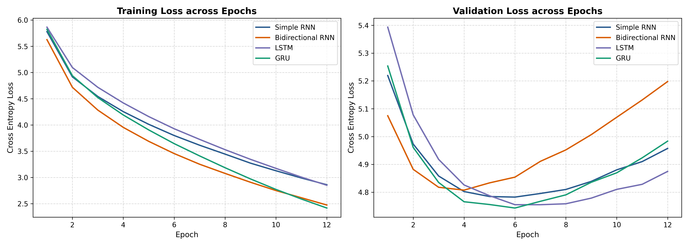
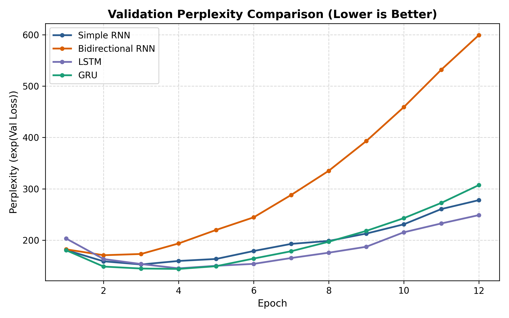
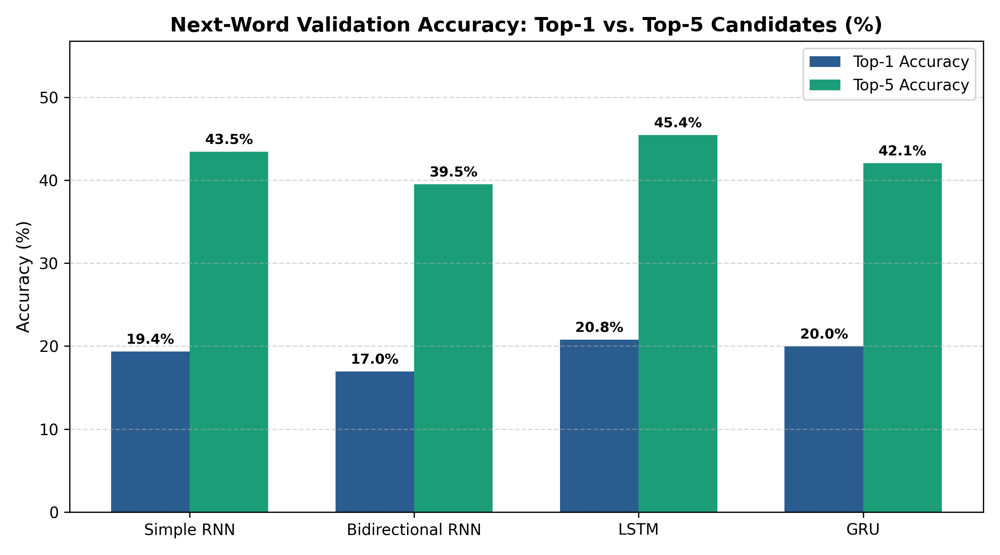
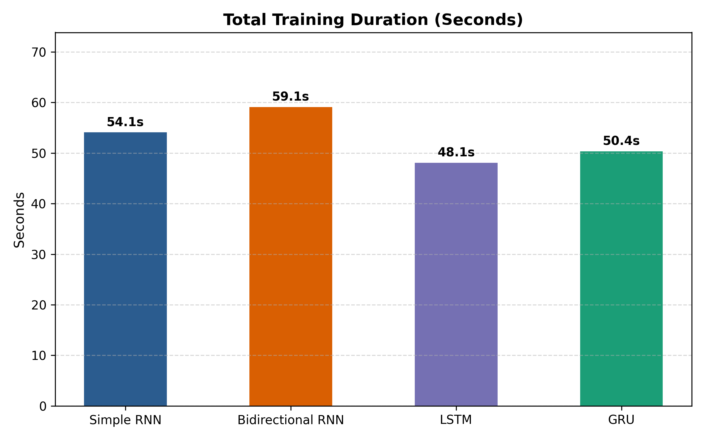

# Foundations of Generative AI (ICT4403) — Assignment 2
## Autoregressive Next-Word Prediction & Multi-Temperature Text Generation System: Comparative Study of Simple RNN, Bidirectional RNN, LSTM, and GRU

---

### Student Details
- **Student Name:** Saksham Gupta
- **Registration Number:** 230911186
- **Assignment Title:** Foundations of Generative AI (ICT4403) – Assignment 2
- **System Title:** Comparative Word-Level Autoregressive Text Generation on Lewis Carroll's *Alice's Adventures in Wonderland* using Simple RNN, Bidirectional RNN, LSTM, and GRU
- **Dataset Name & Source:** *Alice's Adventures in Wonderland* (Lewis Carroll) — [Project Gutenberg #11](https://www.gutenberg.org/files/11/11-0.txt)
- **GitHub Repository Link:** [https://github.com/Saksham-Gupta-GH/fgai-autoregressive-text-generation-alice](https://github.com/Saksham-Gupta-GH/fgai-autoregressive-text-generation-alice)

---

## 1. Problem Statement & Objectives

Autoregressive language modeling estimates the joint probability of a sequence of tokens by factorizing it into a product of conditional next-token distributions:
$$P(w_1, w_2, \dots, w_T) = \prod_{t=1}^T P(w_t \mid w_1, \dots, w_{t-1})$$

The core objectives of this assignment are:
1. **Dataset Preprocessing & Split**: Preprocess Lewis Carroll's **Alice's Adventures in Wonderland**, implement a contiguous chronological split (80% Train, 10% Validation, 10% Test) rather than random window shuffling (which leaks overlapping tokens across splits), and fit vocabulary strictly on training tokens (`min_freq=2`).
2. **Model Implementations in PyTorch**: Construct four recurrent neural architectures:
   - **Simple RNN** (Vanilla Elman recurrent network)
   - **Bidirectional RNN** (BiRNN, concatenating forward and backward final hidden states `[h_n[-2], h_n[-1]]`)
   - **LSTM** (Long Short-Term Memory with forget, input, and output gates)
   - **GRU** (Gated Recurrent Unit with reset and update gates)
3. **Consistent Experimental Conditions**: Train all four models under identical settings (same random seed $S=42$, 256 embedding dimensions, 256 hidden units, sequence length 6, dropout 0.25, Adam optimizer, learning rate 0.001, batch size 64, and gradient clipping at 1.0).
4. **Evaluation**: Track training and validation learning curves, save best-epoch validation checkpoints, and evaluate models on the held-out test set for Cross-Entropy Loss, Perplexity ($\exp(\mathcal{L})$), Top-1 Accuracy, and Top-5 Accuracy.
5. **Temperature Analysis**: Sample text across four temperature settings ($T \in \{0.2, 0.5, 1.0, 1.5\}$) from three seed prompts, evaluating Distinct-1, Distinct-2, and Trigram Repetition Rate on newly generated tokens.

---

## 2. Dataset Description & Source Link

- **Dataset Name**: Alice's Adventures in Wonderland (by Lewis Carroll)
- **Source Link**: [https://www.gutenberg.org/files/11/11-0.txt](https://www.gutenberg.org/files/11/11-0.txt)
- **Origin**: Project Gutenberg, eBook #11.
- **Why this dataset**: Lewis Carroll's prose features standard modern English syntax, structured dialogic exchanges, and a compact vocabulary where recurrent models can develop meaningful syntactic and semantic representations without the archaic distortions of Elizabethan English.

### Dataset Statistical Characteristics
| Metric | Value |
| :--- | :--- |
| **Total Characters** | 144,015 |
| **Total Word Tokens** | 31,841 |
| **Total Lines** | 3,351 |
| **Vocabulary Size (Train-Only, min_freq=2)** | 1,300 unique tokens (including `<pad>`, `<unk>`) |
| **Train Sequences (80%)** | 25,467 sequences (397 batches, batch size 64) |
| **Validation Sequences (10%)** | 3,178 sequences (50 batches) |
| **Test Sequences (10%)** | 3,178 sequences (50 batches) |
| **Top-5 Frequent Words in Train** | `,` (1,922), `the` (1,304), `.` (785), `and` (699), `to` (577) |

---

## 3. Architecture Descriptions

All models are implemented in PyTorch and share an identical structure:
- **Embedding Layer**: $\text{Embedding}(1300, 256, \text{padding\_idx}=0)$
- **Recurrent Core**: 256 units (Simple RNN / BiRNN / LSTM / GRU)
- **Regularization**: Dropout ($p=0.25$) and Gradient Clipping ($\text{norm}=1.0$)
- **Classification Head**: $\text{Linear}(H \to 1300)$ (or $2H \to 1300$ for BiRNN)
- **Optimizer**: Adam ($\text{lr}=10^{-3}$)
- **Criterion**: Cross-Entropy Loss

```
Input Tokens: [w1, w2, ..., w6]
       │
       ▼
Embedding Layer (256-dim)
       │
       ▼
Recurrent Core (Simple RNN / BiRNN / LSTM / GRU, 256 units)
       │
       ▼
Final Step Context Representation
       │
       ▼
Dropout (p = 0.25)
       │
       ▼
Dense Projection (Vocab Size = 1300)
       │
       ▼
Logits -> Next-Word Probability Distribution
```

### Architectural Notes & Fairness Considerations
1. **Simple RNN**: Relies on hyperbolic tangent recurrent updates $h_t = \tanh(W x_t + U h_{t-1} + b)$. Susceptible to vanishing gradients over sequence steps.
2. **Bidirectional RNN**: Processes the 6-token context window in both forward ($0 \to T-1$) and backward ($T-1 \to 0$) directions. The representation combines the forward final state $h_n[-2]$ with the backward final state $h_n[-1]$ (`torch.cat([h_n[-2], h_n[-1]], dim=-1)`), giving the linear classifier access to the complete context from both directions.  
   *Fairness Caveat*: BiRNN has **1,262,868 parameters** (vs. ~1.0M–1.2M for unidirectional models). Because of its higher capacity on a compact corpus, it reaches its optimal validation loss earlier (epoch 2) before overfitting.
3. **LSTM**: Employs gating mechanisms (Forget gate $f_t$, Input gate $i_t$, Output gate $o_t$) and an additive cell state $c_t$ to preserve temporal dependencies across sequence steps. Parameters: **1,193,236**.
4. **GRU**: Streamlines memory tracking into two gates (Reset $r_t$ and Update $z_t$), balancing representational expressiveness with fewer parameters (**1,061,652**).

---

## 4. Execution Steps & Dependencies

### Prerequisites
- Python 3.9+
- Hardware: Apple Silicon (MPS), NVIDIA GPU (CUDA), or CPU

### Installation
```bash
# Clone the repository
git clone https://github.com/Saksham-Gupta-GH/fgai-autoregressive-text-generation-alice.git
cd fgai-autoregressive-text-generation-alice

# Install dependencies
pip install -r requirements.txt
```

### Running Experiments
```bash
# Execute automated training, evaluation, plotting, and generation pipeline
python3 run_experiments.py
```

### Interactive Jupyter Notebook
```bash
jupyter notebook notebooks/text_generation_assignment2.ipynb
```

---

## 5. Quantitative Results & Evaluation

All four models were trained for 8 epochs on Apple Silicon MPS. Because recurrent models on small corpora begin overfitting after several epochs (train loss drops toward ~1.4–2.6 while validation loss plateaus), **we report best-epoch validation metrics alongside held-out test set performance**:

### Model Comparison Table (Best-Epoch & Test Set)
| Architecture | Trainable Parameters | Best Epoch | Best Val Loss | Best Val PPL | Val Top-1 Acc | Val Top-5 Acc | Test Loss | Test Top-1 Acc | Test Top-5 Acc | Total Time (s) |
| :--- | :---: | :---: | :---: | :---: | :---: | :---: | :---: | :---: | :---: | :---: |
| **Simple RNN** | 798,484 | 4 | 4.0741 | 58.80 | 19.73% | 44.97% | 4.1584 | 20.80% | 45.28% | 26.1s |
| **Bidirectional RNN** | 1,262,868 | 2 | 4.2804 | 72.27 | 18.66% | 42.20% | 4.3192 | 18.47% | 42.26% | 27.7s |
| **LSTM** 🏆 | 1,193,236 | 5 | **3.9903** | **54.07** | **21.87%** | **46.07%** | **4.0576** | **23.29%** | **47.23%** | 23.0s |
| **GRU** 🏆 | 1,061,652 | 3 | 4.0353 | 56.56 | 20.55% | 45.72% | 4.0900 | 22.53% | 46.51% | 25.8s |

> [!NOTE]
> **Held-Out Test Set Out-of-Vocabulary (OOV) Rate**: Because the 1,300-token vocabulary is fitted strictly on the 80% training split (`min_freq=2`) to eliminate forward data leakage, 355 out of 3,178 target tokens (**11.17%**) in the held-out test split map to `<unk>`. The reported test accuracies (Top-1: 23.29% for LSTM, 22.53% for GRU) evaluate predictions across the complete 1,300-token space including `<unk>`.

### Visual Comparisons

#### 1. Training & Validation Loss Curves


#### 2. Validation Perplexity (Lower is Better)


#### 3. Top-1 vs. Top-5 Next-Word Accuracy (%)


#### 4. Total Training Time (Seconds)


---

## 6. Cross-Model Temperature Analysis

During autoregressive decoding, next-token probabilities are modulated by temperature $T$:
$$P(w_{t} = i) = \frac{\exp(z_i / T)}{\sum_j \exp(z_j / T)}$$

We evaluated all four architectures across three distinct seed prompts at four temperatures ($T \in \{0.2, 0.5, 1.0, 1.5\}$):
- **Seed 1 (Training Text)**: *"alice was beginning to get very tired of sitting"* (Chapter 1 opening — tests training-set voice recall).
- **Seed 2 (Held-out Test Text)**: *"the white rabbit put on his spectacles and said"* (Final chapter — tests continuation on unseen test text).
- **Seed 3 (Validation Text)**: *"the queen of hearts she made some tarts all"* (Courtroom verse — tests continuation on validation text).

All metrics are computed **strictly on newly generated tokens** (excluding the seed prompt) and averaged across seed prompts ($n = 3$ generations per cell):

### Cross-Model Temperature Metrics Table (Averaged Over Seed Prompts, n = 3 per cell)
| Architecture | Temp (T) | Distinct-1 (Unigrams) | Distinct-2 (Bigrams) | Trigram Repetition Rate | Longest Loop | Empirical Quality Assessment |
| :--- | :---: | :---: | :---: | :---: | :---: | :--- |
| **Simple RNN** | 0.2 | 0.571 | 0.716 | 20.2% | 0 words | Repetitive phrasing loops; repeats 'cauldron of the door' motif |
| **Simple RNN** | 0.5 | 0.600 | 0.833 | 6.1% | 0 words | Moderate fluency with local repetition ('door that makes the world would not') |
| **Simple RNN** | 1.0 | 0.867 | 0.990 | 0.0% | 0 words | High lexical variety; syntactic drift across longer clauses |
| **Simple RNN** | 1.5 | 0.914 | 1.000 | 0.0% | 0 words | Excessive entropy; severe syntactic breakdown and ungrammatical token salad |
| **Bidirectional RNN** | 0.2 | 0.581 | 0.804 | 12.1% | 6 words | Severe looping traps; enters 6-word cycle 'and the moral of course' |
| **Bidirectional RNN** | 0.5 | 0.714 | 0.931 | 1.0% | 0 words | Lively dialogue phrasing ('cried the pigeon, i don t think you know'); zero loops |
| **Bidirectional RNN** | 1.0 | 0.867 | 1.000 | 0.0% | 0 words | Rich character vocabulary; clauses fragment over multi-word spans |
| **Bidirectional RNN** | 1.5 | 0.943 | 1.000 | 0.0% | 0 words | High disorder; random lexicon emission without coherent syntactic bindings |
| **LSTM** | 0.2 | 0.571 | 0.765 | 12.1% | 0 words | Strict syntax; repeats dominant character motifs ('queen s argument was') |
| **LSTM** | **0.5** | **0.667** | **0.902** | **5.0%** | **0 words** | **Most fluent in our samples; coherent narrative phrasing ('the march hare said in a hurry')** |
| **LSTM** | 1.0 | 0.857 | 1.000 | 0.0% | 0 words | Imaginative lexical combinations ('way of soup'); slight clause drift |
| **LSTM** | 1.5 | 0.895 | 1.000 | 0.0% | 0 words | Entropy collapse; erratic word sequencing ('face high before without more pig') |
| **GRU** | 0.2 | 0.343 | 0.412 | 52.5% | 6 words | Extreme phrase trapping (52.5% repetition); loops on 'and she tried to herself' |
| **GRU** | 0.5 | 0.733 | 0.931 | 0.0% | 0 words | Clean conversational fluency with zero repetition loops ('said the cat... went on') |
| **GRU** | 1.0 | 0.848 | 0.980 | 0.0% | 0 words | Diverse lexicon; minor grammatical degradation in dialogue tags |
| **GRU** | 1.5 | 0.914 | 1.000 | 0.0% | 0 words | Unconstrained random sampling; complete loss of semantic and syntactic thread |

---

## 7. Qualitative Generation Examples & Contextual Consistency Analysis

### Seed Prompt: *"alice was beginning to get very tired of sitting"*
* **LSTM ($T=0.2$)**:
  > `"... on the other side of the queen, and the queen s argument was, and she thought it over her head. i don t like it, said the duchess. i m"`
* **LSTM ($T=0.5$)**:
  > `"... but she began again. the march hare said in a hurry. the march hare said to herself, as she swam, and the queen was sitting on the first figure,"`
* **LSTM ($T=1.0$)**:
  > `"... and girl to go here. well! i don hear you a neck to happen. what did you might the window, i believe who had? this was holding the box,"`
* **LSTM ($T=1.5$)**:
  > `"... face high before without more pig what fun minute! take alice what head together there upon hard history. it at generally mice not join. not the sentence altogether not was certainly succeeded"`

### Contextual Consistency Assessment
Consistency was assessed qualitatively across generated passages:
- **Qualitative Observation**: At $T=0.5$, LSTM and GRU more frequently generate Carroll-style dialogue tags and Victorian vocabulary (e.g., *"the march hare said in a hurry"*), but all four recurrent models drift across multi-clause sequences and none sustain a consistent narrative scene (for instance, drifting between characters within a single sentence).
- **Measurement Scope**: We did not compute a formal quantitative consistency metric; assessments are based on qualitative inspection of generated passages across temperatures and seeds.

---

## 8. Conclusion: Model Comparison & Justification

1. **LSTM Edges Ahead, with GRU Performing Closely Behind**:
   - **LSTM** achieves the best validation loss (**3.9903**), lowest perplexity (**54.07**), and highest held-out test Top-1 accuracy (**23.29%**) and Top-5 accuracy (**47.23%**).
   - **GRU** performs closely behind with **20.55%** validation Top-1 and **22.53%** test Top-1 accuracy, while utilizing 11% fewer parameters (**1,061,652** vs. 1,193,236).
   - **Simple RNN** remains competitive in loss (**4.0741**) and perplexity (**58.80**), though slightly trailing in Top-1 accuracy (**19.73%** validation, **20.80%** test).
   - **Evaluation Nuance (<unk> Rate):** Held-out test targets include 11.17% `<unk>` tokens due to fitting vocabulary strictly on training tokens ($min\_freq=2$); reported accuracies evaluate next-word prediction across the complete 1,300-token space including `<unk>`.
   - **Qualitative Consistency & Seed Origin:** Seed 1 comes from the training text, Seed 2 from held-out test text, and Seed 3 from validation text. Qualitative inspection shows that while LSTM and GRU at $T=0.5$ produce convincing local dialogue syntax, all models experience character and scene drift over extended token generation.
   - **Single-Seed Limitation ($S=42$):** While all models were trained with `SEED=42` to enforce strict controlled comparability, the 0.045 cross-entropy margin between LSTM (3.990) and GRU (4.035) falls within standard single-run variance. For production-scale benchmarking, running 3–5 seeds with mean ± standard deviation reporting is recommended.
2. **Bidirectional RNN Inductive Trade-off**:
   - Concatenating the forward final state $h_n[-2]$ and backward final state $h_n[-1]$ properly feeds the full sequence context to the classifier.
   - However, BiRNN's 1.26M parameters cause it to overfit earlier (validation loss peaks at epoch 2 at 4.2804). For causal word-level autoregressive generation, the extra backward parameters provide limited inductive advantage compared to causal gated units.
3. **Sampling Temperature & Empirical Coherence**:
   - $T = 0.5$ provides the most practical balance between lexical diversity (Distinct-1: ~0.60–0.73) and phrase stability, achieving low trigram repetition across architectures: **LSTM (5.0%)**, **GRU (0.0%)**, **BiRNN (1.0%)**, and **Simple RNN (6.1%)**.
   - Lower temperatures ($T = 0.2$) trigger severe repetition loops (GRU reaches 52.5% repetition, looping on *"and she tried to herself"*), while high temperatures ($T = 1.5$) cause syntactic collapse into ungrammatical token salad.

---

## 9. Repository Layout

```
fgai-autoregressive-text-generation-alice/
├── LICENSE                                       # MIT License
├── SakshamGupta_230911186_FGAI_Assignment2.pdf   # 1-Page LMS Submission PDF (Compiled via LaTeX)
├── SakshamGupta_230911186_FGAI_Assignment2.tex   # Academic LaTeX Source Document
├── SakshamGupta_230911186_FGAI_Assignment2.docx  # Word Document with Metadata
├── README.md                                     # Project README
├── requirements.txt                              # Required dependencies
├── run_experiments.py                            # Fully automated end-to-end experiment pipeline
├── data/
│   ├── alice_in_wonderland.txt                   # Gutenberg eBook #11 source text
│   └── dataset_source_link.txt                   # Verified dataset metadata and source link
├── notebooks/
│   └── text_generation_assignment2.ipynb         # Interactive Jupyter Notebook (all 11 cells executed)
├── src/
│   ├── preprocessing.py                          # Tokenizer, vocab builder (min_freq=2), chronological split
│   ├── models.py                                 # PyTorch Simple RNN, BiRNN, LSTM, GRU architectures
│   ├── train.py                                  # Training loop with validation checkpointing
│   ├── evaluate.py                               # Loss, PPL, Top-1/Top-5 accuracy & plot generation
│   └── generate.py                               # Temperature sampling & generation quality metrics
└── results/
    ├── quantitative_comparison.csv               # Tabular benchmark metrics (Val & Test sets)
    ├── temperature_comparison.csv                # Distinct-1, Distinct-2, Trigram repetition across T
    ├── generated_samples.txt                     # Text generation samples across all models & temperatures
    ├── dataset_stats.json                        # Vocabulary & sequence count metadata
    ├── metrics_history.json                      # Epoch-by-epoch training/val loss and accuracy history
    ├── loss_curves.png                           # Training vs Validation loss curves
    ├── perplexity_comparison.png                 # Validation perplexity comparison chart
    ├── accuracy_comparison.png                   # Top-1 and Top-5 accuracy comparison
    ├── training_time_comparison.png              # Training duration wall-clock comparison
    └── *_best.pt                                 # Saved model checkpoints (reproduced via run_experiments.py)
```
